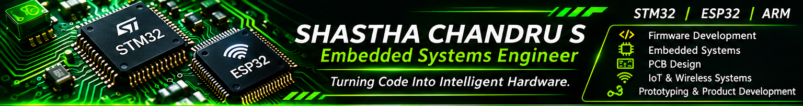

<!-- SHASTHA CHANDRU S | EMBEDDED SYSTEMS ENGINEER -->

  

  <strong>EMBEDDED SYSTEMS ENGINEER</strong> 
  Firmware Development&nbsp; • &nbsp;Microcontrollers&nbsp; • &nbsp;IoT&nbsp; • &nbsp;PCB Design

  
  

---

<table>
  <tr>
    <td width="31%" valign="top">
      <h3 align="center">ENGINEER PROFILE</h3>
      

      
<strong>SHASTHA CHANDRU S</strong> Embedded Systems Engineer

      

        
        
        
      

      

      <strong>CORE AREAS</strong>
      <ul>
        <li>Embedded firmware</li>
        <li>Microcontroller interfacing</li>
        <li>IoT and wireless systems</li>
        <li>PCB design and prototyping</li>
        <li>Technical training</li>
      </ul>
      
<a href="https://github.com/Shastha08">GitHub</a> <a href="https://www.linkedin.com/in/shastha-chandru-s/">LinkedIn</a>

    </td>
    <td width="69%" valign="top">
      <h3>ABOUT ME</h3>
      I am <strong>SHASTHA CHANDRU S</strong>, an Embedded Systems Engineer focused on developing practical electronics solutions through firmware, hardware integration and connected systems.
        
      <strong>Engineering interests</strong>
      <ul>
        <li>STM32 ARM Cortex-M development and register-level programming</li>
        <li>ESP32 firmware, Wi-Fi and IoT applications</li>
        <li>Embedded C/C++ and peripheral drivers</li>
        <li>UART, SPI, I²C, CAN and wireless communication</li>
        <li>PCB design, hardware debugging and prototyping</li>
        <li>Robotics, automation and embedded systems mentoring</li>
      </ul>
p
        

        திருக்குறள் 619 (அதிகாரம்: ஆள்வினையுடைமை)
        தெய்வத்தான் ஆகா தெனினும் முயற்சிதன்  
        மெய்வருத்தக் கூலி தரும்.

    </td>

  </tr>
</table>

---

## TECHNICAL TOOLKIT

<table>
  <tr>
    <td width="70%" valign="top">
      <strong>MICROCONTROLLERS</strong>  
      
       
      
       
      
      
    </td>
    <td width="50%" valign="top">
      <strong>PROGRAMMING</strong>  
      
      
        
      <strong>PROTOCOLS</strong>  
      
      
      
      
      
      
    </td>
  </tr>
  <tr>
    <td valign="top">
      <strong>PCB & SIMULATION</strong>  
      
      
      
      
      
    </td>
    <td valign="top">
      <strong>DEVELOPMENT ENVIRONMENTS</strong>  
      
      
      
      
    </td>
  </tr>
</table>

---

## SELECTED PROJECTS

<table>
  <tr>
    <td width="50%" valign="top">
      <h3>01 · IoT Fingerprint Attendance</h3>
      
<strong>ESP32 · R307S · DS3231 · Google Sheets</strong>

      <ul>
        <li>Fingerprint enrollment and identification</li>
        <li>RTC-based date and time recording</li>
        <li>LCD feedback and online attendance logging</li>
      </ul>
      <a href="https://github.com/Shastha08/ESP32-Based-Biometric-Attendance-Monitoring-System">OPEN REPOSITORY →</a>
    </td>
    <td width="50%" valign="top">
      <h3>02 · PIC GPS Location Display</h3>
      
<strong>PIC16F877A · NEO-7M · LCD</strong>

      <ul>
        <li>UART-based GPS interfacing</li>
        <li>NMEA data parsing</li>
        <li>Latitude and longitude display</li>
      </ul>
      <a href="https://github.com/Shastha08/PIC_GPS">OPEN REPOSITORY →</a>
    </td>
  </tr>
  <tr>
    <td width="50%" valign="top">
      <h3>03 · PIC GSM Communication</h3>
      
<strong>PIC16F877A · SIM900A</strong>

      <ul>
        <li>GSM modem interfacing</li>
        <li>AT-command serial control</li>
        <li>SMS and call functions</li>
      </ul>
      <a href="https://github.com/Shastha08/PIC_GSM">OPEN REPOSITORY →</a>
    </td>
    <td width="50%" valign="top">
      <h3>04 · Embedded Development Projects</h3>
      
<strong>STM32 · ESP32 · LoRa · Robotics</strong>

      <ul>
        <li>STM32 register-level firmware</li>
        <li>ESP32 web-controlled robotics</li>
        <li>LoRa wireless communication</li>
      </ul>
      <a href="https://github.com/Shastha08?tab=repositories">BROWSE ALL REPOSITORIES →</a>
    </td>
  </tr>
</table>

---

## GITHUB PROFILE

  
  

<em>For live contribution history and repository activity, see the GitHub profile's native contribution graph above the pinned repositories.</em>

---

  <strong>TURNING CODE INTO INTELLIGENT HARDWARE.</strong> 
  Embedded Firmware · Connected Devices · Electronic Product Development

